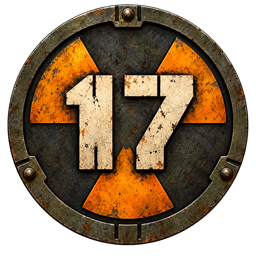

<p align="center">
  
</p>

<h1 align="center">OpenGorky</h1>

<p align="center">
  An open-source reimplementation of the <b>Gorky 17</b> engine<br>
  (<i>Odium</i> in North America, Metropolis Software, 1999)<br>
  for macOS, Linux and Windows, written in Zig + SDL3.
</p>

<p align="center">
  <a href="../../releases/latest"><b>Download</b></a> ·
  <a href="#playing">Playing</a> ·
  <a href="#building">Building</a> ·
  <a href="#tools">Tools</a>
</p>

---

OpenGorky aims to be an **exact port**: the battle rules, AI, scripts, effects and timings are
reconstructed from the original `gorky17.exe`, and gameplay is bit-identical across build
modes and CPU architectures. On top of that it runs natively on modern systems, at high
resolution, with fullscreen scaling and a modern save location.

> **You need the original game files** (for example the GOG version). None are included in
> this repository or in the release packages.

## Download

Prebuilt packages are on the [latest release](../../releases/latest) page:

| Platform | Package | How to run |
|---|---|---|
| macOS 13+ (Apple Silicon and Intel) | `OpenGorky-macos-x86_64-arm64.zip` | Unzip and open `OpenGorky.app`. It asks for the game folder once. |
| Windows 10+ (x86_64) | `opengorky-windows-x86_64.zip` | Unzip and run `OpenGorky.exe`. It asks for the game folder once. SmartScreen may warn: **More info → Run anyway**. |
| Linux x86_64 / aarch64 (glibc 2.41+) | `opengorky-linux-<arch>.tar.xz` | Unpack and run `./opengorky <game dir>`. An icon and a `.desktop` file are included. |

### Game files

Point OpenGorky at the folder of your Gorky 17 installation. It uses only:

| What | Why |
|---|---|
| `dat/` | levels, battles, `common/` graphics, sounds, voices, texts, scripts |
| `avi/` | videos and some music (`*.asf`) |
| `adjust.kdt` | engine tuning (weapons, effects, sound, camera); without it defaults are used |

Nothing else (`gorky17.exe`, DLLs, installer) is used. Original saves are not read.

Other editions on the same engine work too, e.g. the Russian «Горький-18»: file names are
case-insensitive and fonts follow the edition language.

## Playing

| Key | |
|---|---|
| Esc | menu; skip video or scene; close windows |
| Space | next dialogue line; outside scenes toggle the panel |
| I / G | inventory / give |
| 1–6 | select hero |
| F | camera to the selected hero |
| W A S, arrows, screen edge | scroll (Shift faster) |
| Battle: Tab / Q / X or D / E or Enter / P | grid / next weapon / defend / end turn / push |
| Right button | cancel; in battle enter aim mode |
| F10 | scaling: integer / sharp / smooth |
| F11, Alt+Enter, Cmd+Enter | fullscreen |
| `` ` `` or F2 | debug console, only with `console = 1` or `--dev` |

Command line flags: `--mute` (or `OPENGORKY_MUTE=1`), `--no-sfx` (or `OPENGORKY_NO_SFX=1`).
The game folder can also be given with `OPENGORKY_GAME` (macOS app).

### Saves and settings

| | Settings `opengorky.cfg` | Saves |
|---|---|---|
| macOS | `~/Library/Application Support/OpenGorky/` | `…/OpenGorky/saves` |
| Linux | `$XDG_CONFIG_HOME/opengorky/` (`~/.config/opengorky/`) | `$XDG_DATA_HOME/opengorky/saves` (`~/.local/share/opengorky/saves`) |
| Windows | `%APPDATA%\OpenGorky\` | `%APPDATA%\OpenGorky\saves` |

`OPENGORKY_SAVES` overrides the saves folder. Missing keys are appended to `opengorky.cfg`
on save:

| Key | Values |
|---|---|
| `scaling` | `integer` / `sharp` / `smooth` |
| `hires` | render models, shadows and effects at window resolution, up to 4×; `0` = 640×480 |
| `upscale` | `xbr` / `off` — UI sprites at `hires` |
| `fullscreen` | `0` / `1` |
| `fps_limit`, `fps_background` | `60`, `15` |
| `pause_background` | `1` — pause when the window loses focus |
| `log` | `none` / `warn` / `info` |
| `debug`, `console` | debug labels; debug console |
| `game_path` | the game folder |

### Mods

Scripts and objects placed in `<game>/mods` or `<config dir>/mods` (or `$OPENGORKY_MODS`)
are looked up before the game archives, so levels, fighters and weapons can be changed or
added without touching the original files. Custom fighters use the generic class
(`classType = 100`): attacks, AI and resistances come from their `.ftr`/`.wpn` fields.

## Building

Requirements: [Zig 0.17.0](https://ziglang.org/download/), SDL3 and `pkg-config`
(`brew install sdl3` / `apt install libsdl3-dev`). Videos (MS-MPEG4 + WMA/MP3) use the FFmpeg
libraries if found (`brew install ffmpeg` / `libav*-dev`); with `-Dffmpeg=false` an
external `ffmpeg` program is used instead.

```sh
zig build                             # zig-out/bin/opengorky-viewer, zig-out/bin/gorky-tool
zig build test
zig build viewer -- <game dir> --play # build and play
```

- The viewer builds ReleaseFast with debug info by default (`-Dviewer-optimize=safe|debug`).
  ReleaseSmall is avoided: LLVM's MachineOutliner miscompiles on arm64 with Zig 0.17.
- gorky-tool builds ReleaseSafe (`-Dtool-optimize=debug`). `-Dstrip=true` drops debug info.
- Gameplay does not depend on the build mode or the CPU (no `@setFloatMode`).

Regression checks with the game data: `scripts/regress.sh <game dir>`,
`scripts/fullgame.sh <game dir>` (full playthrough), `scripts/linux/check.sh <game dir>`
(everything in a Linux container).

### Packages

```sh
scripts/dist-macos.sh            # zig-out/dist/OpenGorky.app + zip (universal arm64 + x86_64)
scripts/dist-linux.sh [game dir] # zig-out/dist/opengorky-linux-<arch>.tar.xz (Docker)
scripts/dist-windows.sh          # zig-out/dist/opengorky-windows-x86_64.zip (Docker, cross build)
```

- **FFmpeg**: `scripts/build-ffmpeg.sh` builds a minimal FFmpeg 9.0.1 (ASF, MS-MPEG4, WMA,
  MP3, swscale, swresample; ~2 MB), shipped as replaceable shared libraries (LGPL).
- **SDL3**: macOS uses its own universal build (`scripts/build-sdl3.sh`), Linux Debian's,
  Windows the official mingw release.
- **macOS**: ad-hoc signed; set `SIGN_IDENTITY` and `NOTARY_PROFILE` for Developer ID
  signing and notarization. An ad-hoc build downloaded from the internet is blocked by
  Gatekeeper ("Apple could not verify…"): open it via System Settings → Privacy & Security →
  **Open Anyway**, or `xattr -dr com.apple.quarantine OpenGorky.app`.
- **Linux**: built on Debian trixie, libraries in `lib/` with an `$ORIGIN/lib` rpath.
- **Windows**: the viewer is cross-built with Zig, FFmpeg with mingw-w64.
- **CI**: `.github/workflows/release.yml` builds all packages; pushing a `v*` tag, or
  running it manually with a tag (`gh workflow run release.yml -f tag=v0.1.1`), publishes
  a GitHub release.

## Tools

### Resource viewer

```sh
zig build viewer -- <game dir> [01_port/sprite.dat] [--image N] [--shot out.png]
```

Without `--play`: `[` `]` archive, `↑` `↓` resource, `←` `→` frame, Space animate, `L` level
mode. `--shot` renders one frame and exits (`--level`, `--scroll X,Y`, `--time MS`,
`--hide-objects`).

### gorky-tool

```sh
gorky-tool list    <game>/dat/common/other.dat           # archive contents
gorky-tool extract <game>/dat/01_port/other.dat out/01_port
gorky-tool export  <game>/dat/01_port/sprite.dat png/01_port
gorky-tool check   <game>                                # decode all game data
gorky-tool scripts <game> [--api]
gorky-tool world   <game> 01_port 100
gorky-tool listen  <game> 01_port 30 port.wav 1700,200
gorky-tool play    <game> 01_port …                      # headless play scenarios
```

## License

OpenGorky is [MIT](LICENSE). Release packages also contain SDL3 (zlib) and FFmpeg
(LGPL 2.1+, as shared libraries you can replace); their licenses are in the package.
Bundled decoders: [stb_image](https://github.com/nothings/stb) and
[dr_libs](https://github.com/mackron/dr_libs) (public domain / MIT-0).

Gorky 17 and Odium are trademarks of their respective owners. This project is not
affiliated with or endorsed by them and contains no original game content.
